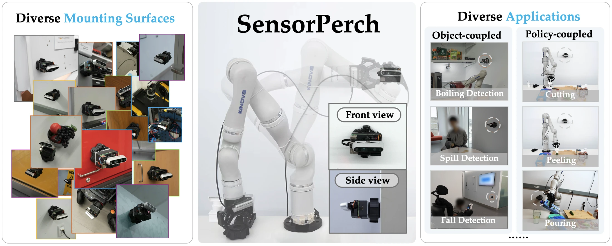

# SensorPerch

[[`Paper`](https://arxiv.org/abs/2607.10682)] [[`Project Page`](https://emprise.cs.cornell.edu/sensorperch/)] [[`BibTeX`](#black_nib-citation)]

This is the official implementation of the paper *SensorPerch: Sense Wherever and Whenever It Matters*, published in IEEE Robotics and Automation Letters [(RA-L)](https://doi.org/10.1109/LRA.2026.3747651), 2026. 

SensorPerch is a lightweight, wireless, reconfigurable sensor platform that a robot can detach and re-attach anywhere in its environment. Neither attached to the robot nor installed as fixed infrastructure, sensors perch wherever and whenever a task needs them.

This repository holds what you need to build and run it:

- **Hardware**: the sensor module, its storage mount (a charging dock), its deployment mount (an attachment ring), and the battery PCB.
- **Software**: sensor streaming and gimbal control, running on the module's Raspberry Pi and on a ROS workstation.

<!-- [](docs/videos/video_intro.mp4) -->



## :fire: Updates

- [Nov 2026] Initial release: hardware (mechanical design and battery PCB) and software.

## :file_folder: Repository layout

```
SensorPerch/
├── hardware/
│   ├── mechanical/     SolidWorks 2024 source of every part
│   └── pcb/            battery PCB: Altium project, Gerber and drill files
├── software/
│   ├── raspberry-pi/   runs on the module's Raspberry Pi: camera stream, gimbal, e-stop
│   ├── workstation/    runs on a ROS workstation: camera receiver, gimbal commands
│   └── esp32/          optional: gimbal control from physical buttons
└── docs/               bill of materials, images and video
```

## :inbox_tray: Getting the files

The CAD and PCB design files are stored with [Git LFS](https://git-lfs.com). Install it before cloning, or the files arrive as small text placeholders:

```bash
git lfs install
git clone https://github.com/iko0725/SensorPerch.git
```

In a clone made without Git LFS, run `git lfs pull` to download the files.

## :hammer_and_wrench: Hardware

- **The sensor module**: a Raspberry Pi 4B, an Intel RealSense D435i on a two-servo gimbal, and an onboard 18650 battery.
- **The storage mount**: a charging dock that holds the module when it is not in use.
- **The deployment mount**: an attachment ring that lets the module perch on the robot or in the environment.
- **The battery PCB**: the Altium project and the Gerber files to order it.

### Specifications

| | |
|---|---|
| Weight | 201.4 g |
| Dimensions | 99 × 66 × 67 mm |
| Battery life | 3.12 hours of continuous streaming with the RealSense D435i |
| Hardware cost | about $94, not including the RealSense D435i ([bill of materials](docs/bom.md)) |

### Design files

Open one of these three top-level files ([more in `hardware/mechanical/`](hardware/mechanical)):

| File | What it is |
|---|---|
| `hardware/mechanical/Assemb - dlc.SLDASM` | The sensor module |
| `hardware/mechanical/Charging Base/Single Camera Base_v2.SLDPRT` | Storage mount: the charging dock |
| `hardware/mechanical/Attachment Ring/Attachment Ring Assemb.SLDASM` | Deployment mount: the attachment ring |

The battery PCB is in [`hardware/pcb/`](hardware/pcb).

### Building one

1. Order the parts in the [bill of materials](docs/bom.md).
2. Order the battery PCB: upload [`hardware/pcb/battery-pcb-v1.2-gerbers.zip`](hardware/pcb/battery-pcb-v1.2-gerbers.zip) to any PCB maker.

   **Note:** our PCB is optional. Any off-the-shelf single-cell (1S) Li-ion charge-and-boost module works instead, as long as it supplies a regulated 5 V at 3 A or more (continuous) to the Raspberry Pi and both servos, and its charging input can be wired to the pogo-pin connector. We designed our own board only to keep the wiring tidy, with no hand-soldered jumper wires.

3. Print the plastic parts.
4. Assemble the module and the mounts following the CAD assemblies in [`hardware/mechanical/`](hardware/mechanical) (see [Design files](#design-files)); they show every part and screw in place.

Wiring:

| Connection | To |
|---|---|
| Blue gimbal servo (MG90S) signal | Raspberry Pi GPIO 12 (BCM) |
| Green gimbal servo (MG90S) signal | Raspberry Pi GPIO 13 (BCM) |
| Intel RealSense D435i | A Raspberry Pi USB 3.0 port |

### Notes on the design files

- `Battery Pack/Battery Housing dlc.SLDPRT` refers to `Battery Pack/battery pack assemb.SLDASM`, an earlier battery pack, so that assembly and its parts are also included.
- `Assemb - dlc.SLDASM` has two suppressed components: `Charging Base/Single Camera Base_v2` and, in `Gimbal Assemb/Gimbal_Assemb.SLDASM`, `prototyping base`.
- `battery-pcb.PcbDoc` was saved on 2026-01-03, after the version 1.2 Gerbers (2025-12-31). Regenerate the outputs from `battery-pcb.OutJob` if the board must match the latest layout.

## :computer: Software

The code is in [`software/`](software); its [README](software/README.md) covers setup, camera streaming and gimbal control.

| Folder | Runs on | What it does |
|---|---|---|
| [`software/raspberry-pi/`](software/raspberry-pi) | The Raspberry Pi inside the SensorPerch module | Streams the camera, drives the gimbal, reads the e-stop button |
| [`software/workstation/`](software/workstation) | A Linux workstation with ROS | Receives the camera stream as a ROS topic, sends gimbal commands |
| [`software/esp32/`](software/esp32) | An ESP32 board (optional) | Drives the gimbal from physical buttons |

<!-- ## License

[MIT](LICENSE). -->

## :black_nib: Citation

If you find SensorPerch useful in your work, please cite:

```bibtex
@ARTICLE{wu2026sensorperchsensematters,
  author={Wu, Zhanxin and Tong, Ruofei and Bhattacharjee, Tapomayukh},
  journal={IEEE Robotics and Automation Letters},
  title={SensorPerch: Sense Wherever and Whenever It Matters},
  year={2026},
  volume={},
  number={},
  pages={1-8},
  keywords={Active Perception;Autonomous Sensor Placement;Viewpoint Selection},
  doi={10.1109/LRA.2026.3747651}
}
```
